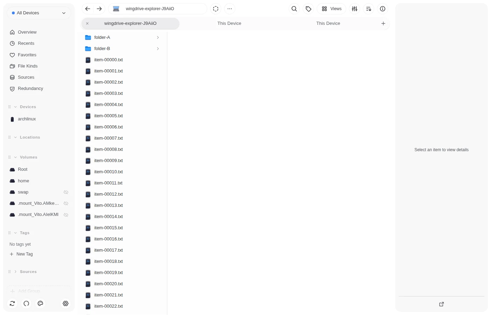
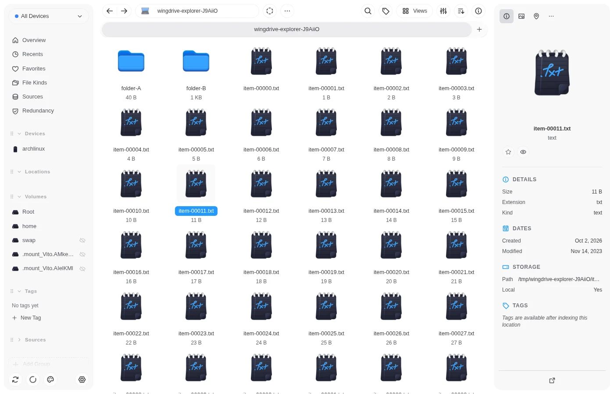
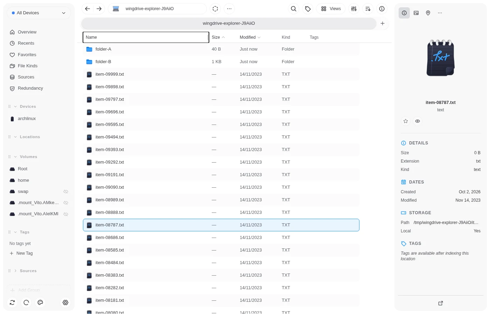
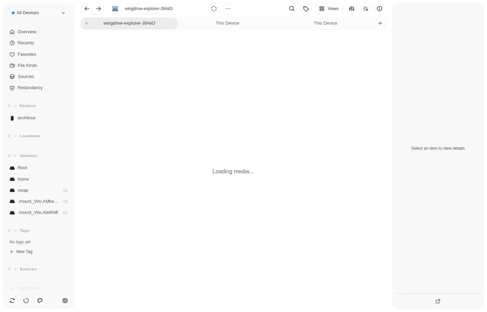
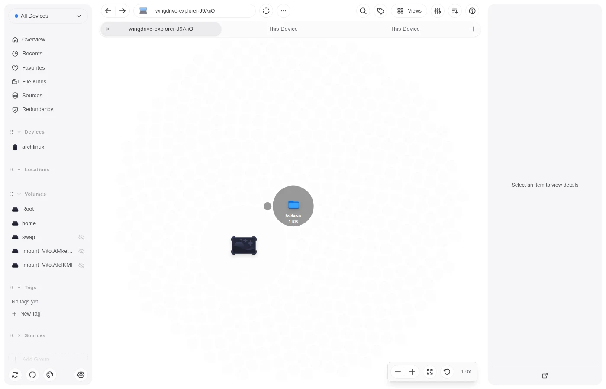

<p align="center">
  
</p>

<h1 align="center">WingDrive</h1>

<p align="center">
  <strong>A local-first file manager that indexes every drive you own.</strong><br/>
  <span>Rust core · Tauri desktop · CLI · Web server · Peer-to-peer sync</span>
</p>

<p align="center">
  <a href="https://github.com/bernardopg/wingdrive/releases">
    
  </a>
  <a href="https://github.com/bernardopg/wingdrive/actions/workflows/ci.yml">
    
  </a>
  
  <a href="https://aur.archlinux.org/packages/wingdrive-bin/">
    
  </a>
</p>

<p align="center">English · <a href="./README.pt.md">Português</a></p>

---

WingDrive is a desktop file manager backed by a daemon that indexes your folders, external drives
and cloud volumes into one library. Files stay where they are. The index makes them searchable,
gives each one a content hash, and lets your own devices sync the library peer-to-peer, without a
central server.

> **Status: alpha.** Linux is the supported platform today, and the current goal is to make
> WingDrive good enough to replace Dolphin, Nautilus or Yazi as the default file manager on Linux.
> macOS and Windows build from source; prebuilt, signed releases for them are planned.

## Features

**File manager**

- Grid, list, column, media and size views, with QuickPreview for images, video, audio, code and
  documents.
- Copy, move, rename, duplicate, delete, and Copy To… / Move To… a chosen folder, with conflict
  handling and undo for rename, move and new folders.
- Opens folders from `xdg-open` and from "Show in folder" in other apps (`org.freedesktop.FileManager1`),
  stays in the tray, and starts with the session.
- Open With, open terminal here, new empty file, symbolic links, permissions and owner, compress and
  extract, SHA-256 checksums, select by pattern and invert selection.
- Real folder sizes, including folders that are not indexed yet.

**Index and search**

- Every file gets a BLAKE3 content identity, so the same file on two devices is recognized as one.
- Search refines by kind, extension, size, date and hidden files, with counts over the whole result.
- A filesystem watcher keeps the index current; unplugged drives show as offline.

**Across devices**

- Pairing and library sync between your own devices over Iroh/QUIC.
- Cloud volumes through OpenDAL (S3, Google Drive, Dropbox, OneDrive, Azure Blob, GCS).
- `wing-server` serves the same interface in a browser for headless machines.

**Interface**

- English and Brazilian Portuguese. Translations live in Crowdin.
- Built-in themes, including Catppuccin, Gruvbox, Solarized, Rosé Pine, Dracula and Tokyo Night.

<div align="center">
  
  
  
  
  
</div>

## What's new

Every release is listed in [CHANGELOG.md](./CHANGELOG.md), and the
[Releases page](https://github.com/bernardopg/wingdrive/releases) has the downloads for each tag.

## Platforms

| Platform | Status |
|----------|--------|
| Linux (x86_64) | Supported: AppImage, Debian package, AUR (`wingdrive-bin`) |
| Headless server | `wing-server` with the web interface, Docker image on GHCR |
| macOS | Builds from source; prebuilt release planned (milestone M3) |
| Windows | Builds from source; prebuilt release planned (milestone M3) |
| iOS, Android | In development (`apps/mobile`), no release yet |

## Install

Full guide: [docs/readme/installation.md](./docs/readme/installation.md).

**Arch Linux and derivatives (AUR):**

```bash
yay -S wingdrive-bin
```

**Other Linux distributions:** download the AppImage or the `.deb` from
[GitHub Releases](https://github.com/bernardopg/wingdrive/releases). Each release has a
`SHA256SUMS` file.

**Headless server** (web interface on port 8080, data in the `wingdrive-data` volume; see
[Linux deployment](./docs/cli/linux-deployment.mdx)):

```bash
docker run -d -p 8080:8080 -p 7373:7373 \
  -v wingdrive-data:/data -v /path/to/files:/mnt/files:ro \
  ghcr.io/bernardopg/wingdrive/server
```

**From source** (Rust from `rust-toolchain.toml`, [Bun](https://bun.sh) 1.3+,
[just](https://github.com/casey/just)):

```bash
git clone https://github.com/bernardopg/wingdrive
cd wingdrive
just setup         # native dependencies and .cargo/config.toml
just dev-desktop   # desktop app; starts its own daemon
just cli --help    # the `wing` CLI
```

## Architecture

One `wing-daemon` process owns all state. The desktop app, the `wing` CLI, the web interface and
`wing-server` are thin clients that speak JSON-RPC to it. The mobile app embeds the same core as a
library.

Stack: Rust, Tokio, SQLite (SeaORM), Iroh/QUIC, BLAKE3, OpenDAL, Tauri 2, React 19.
Details: [docs/readme/architecture.md](./docs/readme/architecture.md) and the subsystem docs in
[`docs/core`](./docs/core).

## Privacy and security

- **Local-first:** indexing, thumbnails and search run on your machine. No telemetry or analytics.
- **Encrypted transport:** peer-to-peer traffic between paired devices uses QUIC with TLS.
- **Your storage:** WingDrive reads your files in place; it does not upload them anywhere you did not
  add as a volume.
- **Destructive operations are guarded:** secure delete refuses copy-on-write filesystems, moves
  and copies refuse to write into their own source, and the daemon will not eject system mounts.

Library encryption at rest is not available yet. Report vulnerabilities as described in
[SECURITY.md](./SECURITY.md).

## Roadmap

| Milestone | Goal |
|-----------|------|
| M1 (done) | Desktop file manager on Linux, from a production bundle |
| M2 (now) | Default file manager on Linux: daily use without falling back to another one |
| M3 | macOS and Windows releases, signed installers, copy preflight and wider undo |
| M4 | Cross-device features: file sync, public sharing, Wingdrop |

Details in [.tasks/ROADMAP.md](./.tasks/ROADMAP.md) (Portuguese).

## Contributing

Read [CONTRIBUTING.md](./CONTRIBUTING.md) and [AGENTS.md](./AGENTS.md) first. Run `just ci-local`
before you push; it runs the same gates as CI. Bugs and feature requests go to
[Issues](https://github.com/bernardopg/wingdrive/issues/new/choose); questions to
[Discord](https://discord.gg/gTaF2Z44f5).

## License

**Apache-2.0**, see [LICENSE](./LICENSE). File-kind icons in `packages/assets/icons` stay under
GPL-3.0-only; see [NOTICE.md](./NOTICE.md).
