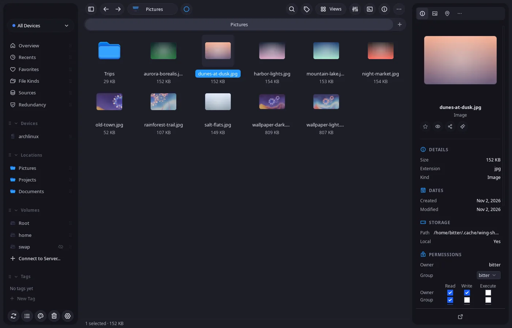
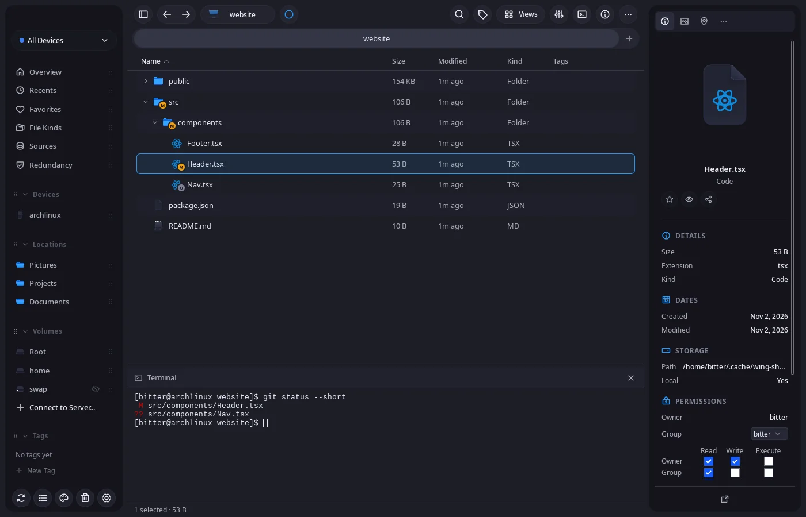
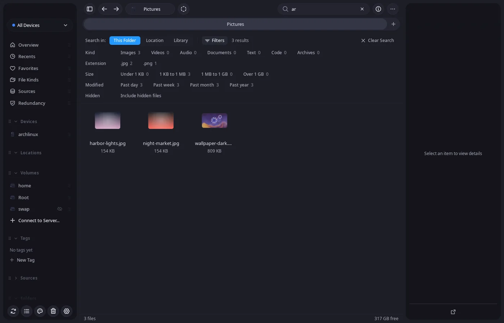
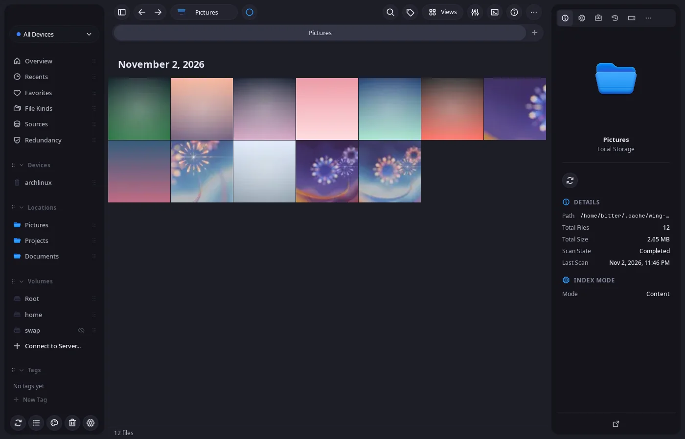
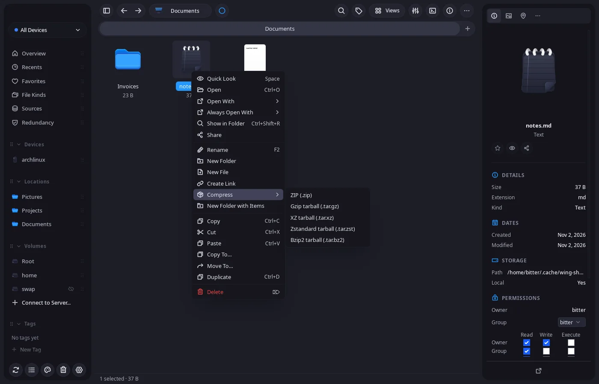

  

<h1 align="center">WingDrive</h1>

  <strong>Every drive you own, in one fast file manager.</strong> 
  Local-first. Indexed. Yours.

  
  
  
  
  

  
  
  
  
  
  

  <a href="#install">Install</a> ·
  <a href="#highlights">Highlights</a> ·
  <a href="#documentation">Docs</a> ·
  <a href="#roadmap">Roadmap</a> ·
  <a href="#support-the-project">Support</a> ·
  <a href="./README.pt.md">Português</a>

  

WingDrive is a desktop file manager for Linux with a daemon that indexes your folders, external
drives and cloud volumes into one library. Files stay where they are; the index makes them fast to
browse, search and recognize across your own devices. No account, no telemetry, no central server.

> **Alpha.** Linux is the supported platform. The current goal (milestone M2) is to replace
> Dolphin, Nautilus or Yazi as the default file manager. macOS and Windows build from source.

## Install

| Where | How |
|---|---|
| Arch Linux and derivatives | `yay -S wingdrive-bin` |
| Any Linux (x86_64) | AppImage or `.deb` from [Releases](https://github.com/bernardopg/wingdrive/releases/latest), with `SHA256SUMS` |
| Headless server | `docker run -d -p 8080:8080 -v wingdrive-data:/data ghcr.io/bernardopg/wingdrive/server` |
| From source | `just setup && just dev-desktop` ([guide](./docs/readme/installation.md)) |

After installing, WingDrive can open folders for `xdg-open` and for "Show in folder" in other apps,
start with your session and stay in the tray.

## Highlights

<table>
  <tr>
    <td width="50%" valign="top">
      
      
<strong>Work where your code lives.</strong> Git emblems on files and folders, expandable
      folders in the list, and a terminal docked under the view (F4) that follows you around.

    </td>
    <td width="50%" valign="top">
      
      
<strong>Find it in seconds.</strong> Search refines by kind, extension, size, date and hidden
      files, with counts over the whole result.

    </td>
  </tr>
  <tr>
    <td width="50%" valign="top">
      
      
<strong>See folders your way.</strong> Grid, list, columns, media and size views, sections by
      kind or date, and Quick Preview for images, video, audio, PDF, text and code.

    </td>
    <td width="50%" valign="top">
      
      
<strong>Everything a file manager should do.</strong> Copy To and Move To, compress and
      extract, templates, Dolphin service menus, permissions, SHA-256 checksums, and undo.

    </td>
  </tr>
</table>

**Also in the box**

- Every file gets a BLAKE3 content identity, so the same file on two devices is one file.
- Pair your own devices over Iroh/QUIC to sync the library and send files with Wingdrop.
- Cloud volumes through OpenDAL: S3, Google Drive, Dropbox, OneDrive, Azure Blob and GCS.
- `wing` CLI and `wing-server` for scripts and headless machines, both on the same daemon.
- English and Brazilian Portuguese, and themes such as Catppuccin, Gruvbox, Dracula and Tokyo Night.

## Documentation

| Topic | Start here |
|---|---|
| Install and first run | [Installation](./docs/readme/installation.md) · [Get started](./docs/overview/get-started.mdx) |
| Libraries and locations | [Manage libraries](./docs/overview/manage-libraries.mdx) · [Add locations](./docs/overview/add-index-locations.mdx) |
| Server and CLI | [Self-hosting](./docs/overview/self-hosting.mdx) · [Linux deployment](./docs/cli/linux-deployment.mdx) · [CLI](./docs/cli/overview.mdx) |
| Devices and sync | [Pairing](./docs/core/pairing.mdx) · [Library sync](./docs/core/library-sync.mdx) · [Cloud](./docs/core/cloud-integration.mdx) |
| How it works | [Architecture](./docs/readme/architecture.md) · [Core architecture](./docs/core/architecture.mdx) · [Indexing](./docs/core/indexing.mdx) |
| Extensions | [Extension SDK](./docs/extensions/introduction.mdx) |
| Contributing | [CONTRIBUTING](./CONTRIBUTING.md) · [AGENTS](./AGENTS.md) · [Dev environment](./docs/core/development-environment.mdx) · [Testing](./docs/core/testing.mdx) |
| Project | [Changelog](./CHANGELOG.md) · [Coverage](./COVERAGE.md) · [Roadmap](./.tasks/ROADMAP.md) · [Security](./SECURITY.md) · [Credits](./CREDITS.md) |

## How it works

One `wing-daemon` owns all state. The desktop app (Tauri 2 + React 19), the `wing` CLI and
`wing-server` with its web interface are thin clients that speak JSON-RPC to it; the mobile app
embeds the same Rust core. Stack: Rust, Tokio, SQLite (SeaORM), Iroh/QUIC, BLAKE3, OpenDAL.

Privacy by design: indexing, thumbnails and search run on your machine, traffic between paired
devices is encrypted, and destructive operations are guarded (secure delete refuses copy-on-write
filesystems, copies refuse to write into their own source, system mounts are never ejected).

## Roadmap

| Milestone | What it brings |
|---|---|
| **M1** · done | A reliable desktop file manager on Linux, from a production bundle |
| **M2** · now | The default file manager on Linux: dual-pane Explorer (F3), a full day of use without falling back |
| **M3** · next | Signed releases for macOS and Windows, auto-updates, copy preflight and an undo journal |
| **M4** | File sync between devices, public sharing links, Wingdrop to nearby devices, Tailscale |
| **M5** | Semantic search, WASM extensions, encryption at rest, Android and iOS releases |

The live plan, sprint by sprint, is in [`.tasks/`](./.tasks/ROADMAP.md) (Portuguese).

## Support the project

WingDrive is built in the open by one developer. If it saves you time, consider
[sponsoring on GitHub](https://github.com/sponsors/bernardopg). Bug reports, ideas and pull
requests help just as much: [Issues](https://github.com/bernardopg/wingdrive/issues/new/choose) ·
[Discussions](https://github.com/bernardopg/wingdrive/discussions).

## Contact

**Bernardo Gomes**, author and maintainer

- Email: [bernardo.gomes@bebitterbebetter.com.br](mailto:bernardo.gomes@bebitterbebetter.com.br)
- Website: [bebitterbebetter.com.br](https://bebitterbebetter.com.br)
- Discord: `omg_bitter`
- Instagram: [@be.pgomes](https://instagram.com/be.pgomes)

Report security issues privately through [GitHub Security Advisories](https://github.com/bernardopg/wingdrive/security/advisories/new) ([SECURITY.md](./SECURITY.md)), not in public issues.

## License

[Apache-2.0](./LICENSE). WingDrive started from the Spacedrive codebase; that origin and every
third-party notice are in [CREDITS.md](./CREDITS.md). File-kind icons in `packages/assets/icons` stay
under GPL-3.0-only.
