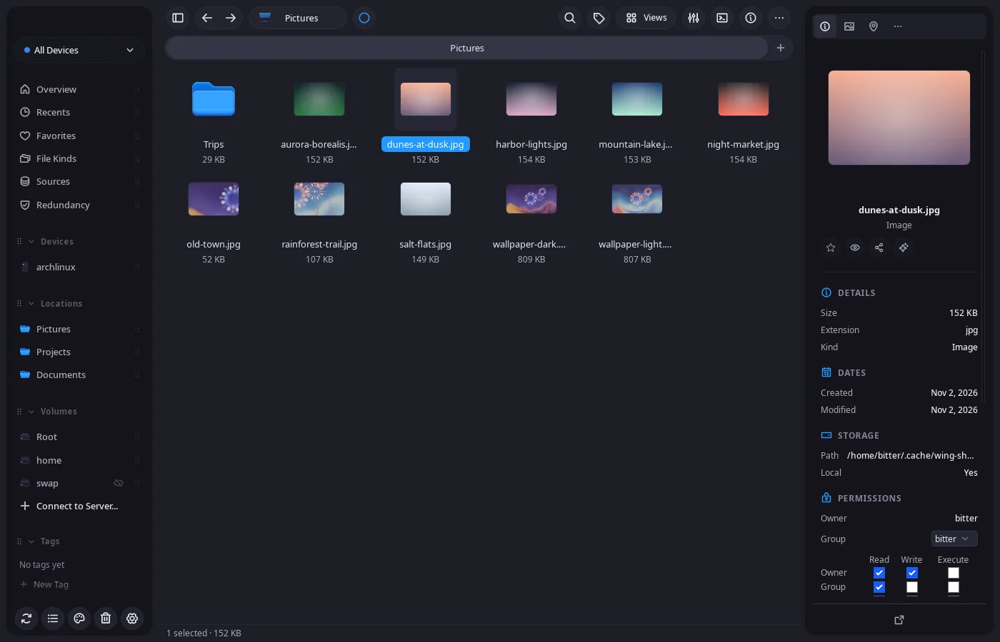
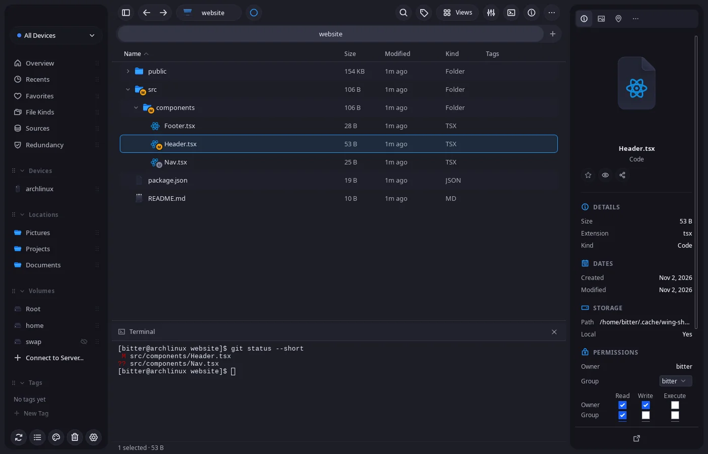
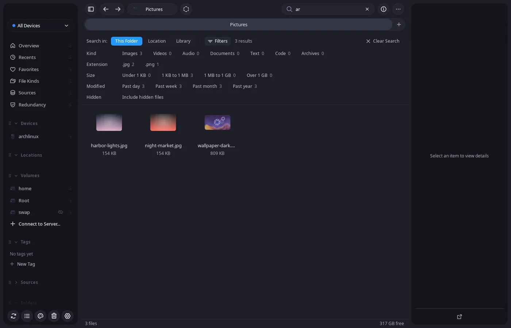
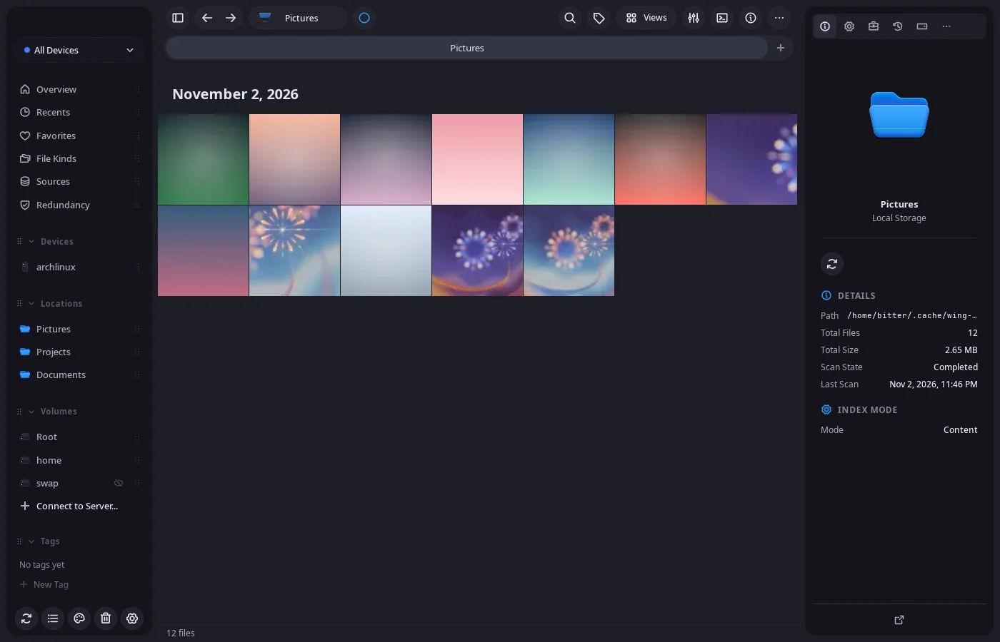
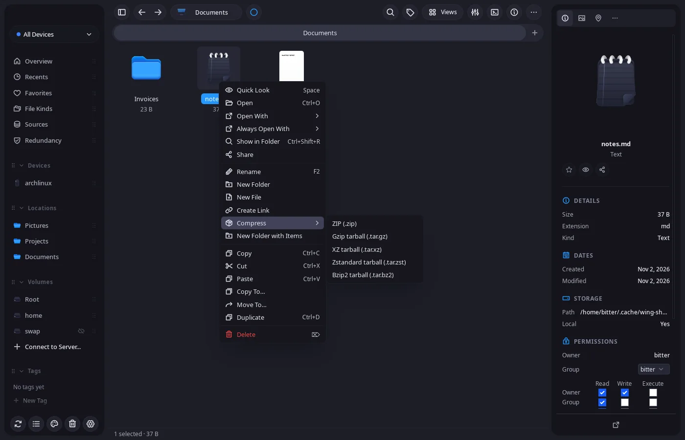

  

<h1 align="center">WingDrive</h1>

  <strong>Todos os seus discos num gerenciador de arquivos rápido.</strong> 
  Local-first. Indexado. Seu.

  
  
  
  
  

  
  
  
  
  
  

  <a href="#instalação">Instalação</a> ·
  <a href="#destaques">Destaques</a> ·
  <a href="#documentação">Docs</a> ·
  <a href="#roadmap">Roadmap</a> ·
  <a href="#apoie-o-projeto">Apoie</a> ·
  <a href="./README.md">English</a>

  

O WingDrive é um gerenciador de arquivos desktop para Linux com um daemon que indexa suas pastas,
discos externos e volumes de nuvem numa biblioteca só. Os arquivos ficam onde estão; o índice deixa
tudo rápido de navegar, buscar e reconhecer entre os seus aparelhos. Sem conta, sem telemetria, sem
servidor central.

> **Alpha.** O Linux é a plataforma suportada. A meta atual (milestone M2) é substituir o Dolphin,
> o Nautilus ou o Yazi como gerenciador de arquivos padrão. Desde a 3.0 há instaladores para Windows,
> em beta: não são assinados e foram menos testados que no Linux. O macOS compila a partir do código.

## Instalação

| Onde | Como |
|---|---|
| Arch Linux e derivados | `yay -S wingdrive-bin` |
| Qualquer Linux (x86_64) | AppImage ou `.deb` em [Releases](https://github.com/bernardopg/wingdrive/releases/latest), com `SHA256SUMS` |
| Windows 10 e 11 (x64), beta | `.exe` ou `.msi` em [Releases](https://github.com/bernardopg/wingdrive/releases/latest), com `SHA256SUMS-windows`. Sem assinatura, então o SmartScreen avisa |
| Servidor sem interface | `docker run -d -p 8080:8080 -v wingdrive-data:/data ghcr.io/bernardopg/wingdrive/server` |
| A partir do código | `just setup && just dev-desktop` ([guia](./docs/readme/installation.md)) |

Depois de instalado, o WingDrive pode abrir pastas pelo `xdg-open` e pelo "Mostrar na pasta" de
outros apps, iniciar com a sessão e ficar na bandeja.

## Destaques

<table>
  <tr>
    <td width="50%" valign="top">
      
      
<strong>Trabalhe onde o código está.</strong> Emblemas do Git em arquivos e pastas, pastas
      que expandem na lista e um terminal embutido sob a vista (F4) que acompanha a navegação.

    </td>
    <td width="50%" valign="top">
      
      
<strong>Ache em segundos.</strong> A busca filtra por tipo, extensão, tamanho, data e
      arquivos ocultos, com contagens sobre o resultado inteiro.

    </td>
  </tr>
  <tr>
    <td width="50%" valign="top">
      
      
<strong>Veja as pastas do seu jeito.</strong> Vistas em grade, lista, colunas, mídia e
      tamanho, seções por tipo ou data, e Visualização rápida para imagem, vídeo, áudio, PDF, texto e código.

    </td>
    <td width="50%" valign="top">
      
      
<strong>Tudo que um gerenciador de arquivos faz.</strong> Copiar para e Mover para,
      compactar e extrair, modelos, service menus do Dolphin, permissões, checksum SHA-256 e desfazer.

    </td>
  </tr>
</table>

**E mais**

- Cada arquivo ganha uma identidade de conteúdo BLAKE3, então o mesmo arquivo em dois aparelhos é um só.
- Pareie seus aparelhos via Iroh/QUIC para sincronizar a biblioteca e enviar arquivos com o Wingdrop.
- Volumes de nuvem via OpenDAL: S3, Google Drive, Dropbox, OneDrive, Azure Blob e GCS.
- CLI `wing` e `wing-server` para scripts e máquinas sem interface, no mesmo daemon.
- Inglês e português do Brasil, e temas como Catppuccin, Gruvbox, Dracula e Tokyo Night.

## Documentação

| Assunto | Comece por |
|---|---|
| Instalação e primeiro uso | [Instalação](./docs/readme/installation.md) · [Primeiros passos](./docs/overview/get-started.mdx) |
| Bibliotecas e locations | [Gerenciar bibliotecas](./docs/overview/manage-libraries.mdx) · [Adicionar locations](./docs/overview/add-index-locations.mdx) |
| Servidor e CLI | [Self-hosting](./docs/overview/self-hosting.mdx) · [Deploy no Linux](./docs/cli/linux-deployment.mdx) · [CLI](./docs/cli/overview.mdx) |
| Aparelhos e sync | [Pareamento](./docs/core/pairing.mdx) · [Sync da biblioteca](./docs/core/library-sync.mdx) · [Nuvem](./docs/core/cloud-integration.mdx) |
| Como funciona | [Arquitetura](./docs/readme/architecture.md) · [Arquitetura do core](./docs/core/architecture.mdx) · [Indexação](./docs/core/indexing.mdx) |
| Extensões | [SDK de extensões](./docs/extensions/introduction.mdx) |
| Contribuir | [CONTRIBUTING](./CONTRIBUTING.md) · [AGENTS](./AGENTS.md) · [Ambiente de dev](./docs/core/development-environment.mdx) · [Testes](./docs/core/testing.mdx) |
| Projeto | [Changelog](./CHANGELOG.md) · [Cobertura](./COVERAGE.md) · [Roadmap](./.tasks/ROADMAP.md) · [Segurança](./SECURITY.md) · [Créditos](./CREDITS.md) |

A documentação técnica está em inglês; o planejamento em `.tasks/` está em português.

## Como funciona

Um `wing-daemon` guarda todo o estado. O app desktop (Tauri 2 + React 19), a CLI `wing` e o
`wing-server` com a interface web são clientes leves que falam JSON-RPC com ele; o app mobile embute
o mesmo core em Rust. Stack: Rust, Tokio, SQLite (SeaORM), Iroh/QUIC, BLAKE3, OpenDAL.

Privacidade por padrão: indexação, miniaturas e busca rodam na sua máquina, o tráfego entre
aparelhos pareados é cifrado e as operações destrutivas têm proteção (a exclusão segura recusa
sistemas de arquivos copy-on-write, cópias não escrevem dentro da própria origem e montagens do
sistema nunca são ejetadas).

## Roadmap

| Milestone | O que traz |
|---|---|
| **M1** · feito | Um gerenciador de arquivos desktop confiável no Linux, a partir de um bundle de produção |
| **M2** · agora | O gerenciador padrão no Linux: Explorer com painel duplo (F3), um dia inteiro de uso sem voltar a outro |
| **M3** · depois | Releases assinadas para macOS e Windows, atualização automática, pré-checagem de cópia e journal de desfazer |
| **M4** | Sync de arquivos entre aparelhos, links públicos de compartilhamento, Wingdrop para aparelhos próximos, Tailscale |
| **M5** | Busca semântica, extensões WASM, criptografia em repouso, releases para Android e iOS |

O plano vivo, sprint a sprint, está em [`.tasks/`](./.tasks/ROADMAP.md).

## Apoie o projeto

O WingDrive é feito às claras por um único desenvolvedor. Se ele economiza seu tempo, considere
[patrocinar no GitHub](https://github.com/sponsors/bernardopg). Relatos de bug, ideias e pull
requests ajudam tanto quanto: [Issues](https://github.com/bernardopg/wingdrive/issues/new/choose) ·
[Discussions](https://github.com/bernardopg/wingdrive/discussions).

## Contato

**Bernardo Gomes**, autor e mantenedor

- E-mail: [bernardo.gomes@bebitterbebetter.com.br](mailto:bernardo.gomes@bebitterbebetter.com.br)
- Site: [bebitterbebetter.com.br](https://bebitterbebetter.com.br)
- Discord: `omg_bitter`
- Instagram: [@be.pgomes](https://instagram.com/be.pgomes)

Relate falhas de segurança em particular pelo
[GitHub Security Advisories](https://github.com/bernardopg/wingdrive/security/advisories/new)
([SECURITY.md](./SECURITY.md)), nunca em issues públicas.

## Licença

[Apache-2.0](./LICENSE). O WingDrive nasceu do código do Spacedrive; essa origem e todos os avisos
de terceiros estão em [CREDITS.md](./CREDITS.md). Os ícones de tipos de arquivo em
`packages/assets/icons` continuam sob GPL-3.0-only.
