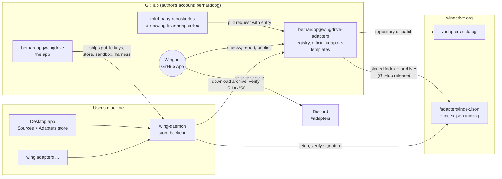
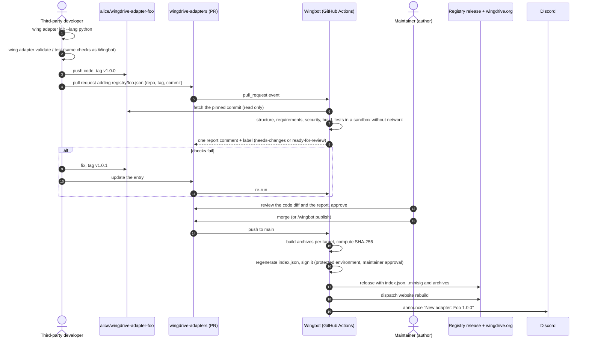
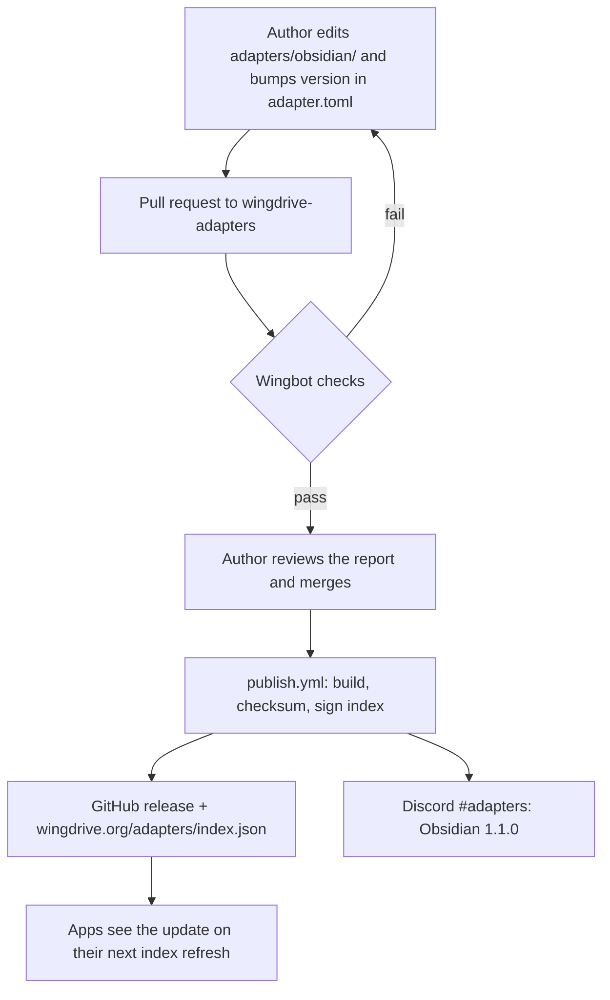
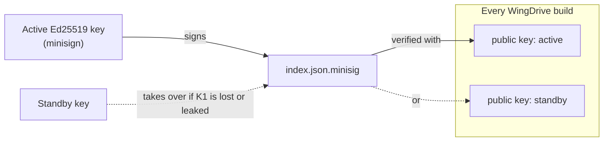
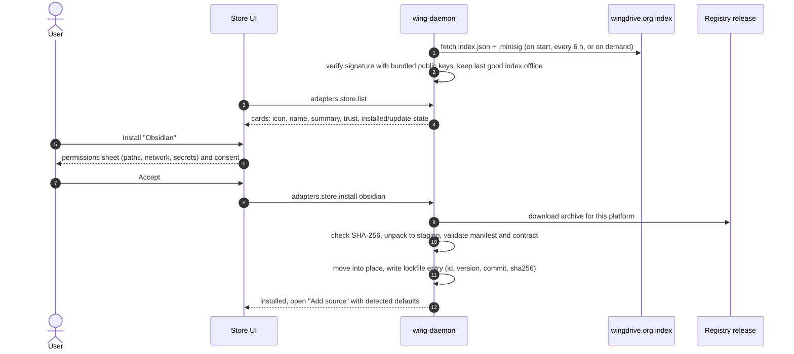
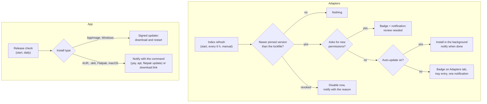

# Adapter Store Architecture

Status: design, 2026-11-24. Epic `ADAPT-000` in `.tasks/adapters/`.

WingDrive indexes external data (notes, mail, repositories, chat, browser history) through
**adapters**: small programs that read a source and print records. This document describes how
adapters are written, reviewed, published, installed, updated and announced, for adapters written by
the author and by third parties.

## Goals

- A user installs an adapter from a store in the app, the way a phone installs an app.
- Anyone can publish an adapter by pull request, and an automatic review by Wingbot runs before a
  human looks at it.
- What a user installs is exactly what was reviewed: pinned commit, checksum, signed index.
- An adapter can read only what it declares, and the user sees that before installing.
- Users learn about updates to WingDrive and to their adapters without checking by hand.
- Everything runs on GitHub Actions in public repositories, so it costs nothing to operate.

## The pieces



### Two repositories that work side by side

| Repository | Holds | Changes when |
|---|---|---|
| `bernardopg/wingdrive` | The app: daemon store backend, store UI, sandbox, contract harness, `wing adapter` and `wing adapters` commands, the bundled registry public keys | The app releases |
| `bernardopg/wingdrive-adapters` | The registry index sources, the official adapters, the templates, the review and publish workflows | An adapter is added or updated |

Third-party adapters live in their authors' repositories. The registry only stores an entry that
points at a tag and pins a commit, like a package index.

Registry repository layout:

```
wingdrive-adapters/
├── registry/            one JSON entry per published adapter (the source of index.json)
│   ├── obsidian.json
│   └── foo.json         points at github.com/alice/wingdrive-adapter-foo @ v1.2.0
├── adapters/            official adapters, reviewed like any other
│   └── obsidian/        adapter.toml, sync.py or src/, fixtures/, tests/, icon.svg, README.md
├── drafts/              unfinished prototypes, never published
├── templates/
│   ├── python/
│   └── rust/
├── schema/              JSON Schema for entries and adapter.toml
├── keys/                public keys (active, standby) and the rotation log
└── .github/workflows/   validate.yml, build.yml, publish.yml, revoke.yml
```

## What an adapter is

An adapter is a process. The daemon starts it, writes the source config and the last cursor as
JSON on stdin, and reads JSON lines from stdout: records, deletions, a new cursor, progress and
errors. The contract is versioned (`contract = 1`) and documented in `docs/core/adapters.mdx`
(ADAPT-003). Because it is a process, an adapter can be a Python script or a compiled binary.

| Field in `adapter.toml` | Meaning |
|---|---|
| `id`, `name`, `version`, `author`, `license` | Identity; `id` is unique in the registry |
| `summary` | Up to two lines (140 characters) shown on the store card |
| `icon` | Square SVG shown on the card |
| `contract` | Contract version the adapter speaks |
| `runtime` | `python3` (script) or `binary` (compiled by the registry's CI) |
| `[permissions]` | `read` paths, `network` hosts, `secrets` keys, `tools` it may run |
| `[[config]]` | Fields the user fills when adding a source (paths get platform defaults) |
| `[models]`, `[search]` | Schema of the records and how search shows them |

## Trust levels

| Level | Who | Shown as | Review |
|---|---|---|---|
| `official` | Adapters in `adapters/` of the registry, by the author | Official badge | Same checks as everyone, plus the author's approval |
| `verified` | Third parties with a track record (two or more approved adapters, no revocations) | Verified badge | Checks and a maintainer approval |
| `community` | Any other third party | Community badge, permissions shown more prominently | Checks and a maintainer approval |

## Publishing

### A third party publishes a new adapter



### The author publishes an official adapter

The author follows the same path. The only difference is where the code lives: in
`adapters/<id>/` of the registry, so one pull request carries both the code and the entry.



### Updating an adapter

An update is a pull request that changes the pinned commit (and the version). Wingbot shows the code
diff since the last published pin, and it flags any new permission. A new permission means the
app asks the user again before installing that update, even with automatic updates on.

### Revoking a version

`revoke.yml` (maintainer only) adds a version to the index's revocation list, publishes the signed
index, and posts a warning on Discord. Apps disable a revoked version on their next refresh and tell
the user why.

## Wingbot's checks

Wingbot is a GitHub App owned by the author's account (ADAPT-016). Workflows mint a short-lived
token for it with `actions/create-github-app-token`, so comments, labels and publish commits come
from `wingbot[bot]`. All logic runs in GitHub Actions; there is no server.

| Group | Check | Fails when |
|---|---|---|
| Structure | Entry and `adapter.toml` match the schemas | A field is missing, unknown or of the wrong type |
| Structure | Identity | `id` is taken, differs between entry and manifest, or the version did not increase |
| Structure | Presentation | Summary over two lines, icon not a square SVG or over 64 KB, README without Setup, Data and Privacy sections |
| Structure | Repository hygiene | No OSI license, binaries or vendored dependencies committed, files over the size limit |
| Requirements | Contract | `contract` not supported by the current app |
| Requirements | Pin | Commit not reachable from the tag, or tag moved after review |
| Requirements | Tests | No tests, tests fail, or the contract harness fails against the adapter's fixtures |
| Requirements | Platforms and runtime | Declared platforms do not build or run in CI |
| Security | Permissions | Code opens network hosts, paths, secrets or tools it does not declare (static scan and a sandbox run with everything undeclared blocked) |
| Security | Dangerous code | `eval`/`exec` of fetched data, shell-outs to undeclared tools, writes outside its state directory, obfuscated code |
| Security | Dependencies | Known vulnerabilities (`pip-audit`, `cargo audit`), dependencies not pinned |
| Security | Secrets | Secret scan (TruffleHog) finds credentials |
| Build | Compiled adapters | The registry's CI builds every target from source with locked dependencies; author-uploaded binaries are refused |

Human review (the maintainer) covers what a machine cannot judge: whether the adapter does what it
says, whether the data it reads is reasonable for its purpose, and naming. The guidelines
(`docs/core/adapter-guidelines.mdx`, ADAPT-008) mark each rule as automated or human.

Maintainer commands in a pull request comment: `/wingbot recheck`, `/wingbot publish`,
`/wingbot reject <reason>`. Anyone else's command is ignored with a reply.

### Workflows in the registry

| Workflow | Trigger | Does | Secrets |
|---|---|---|---|
| `validate.yml` | Pull request | All checks in a sandbox; Wingbot report and labels | Wingbot token (read and comment) |
| `build.yml` | Called by validate and publish | Build archives per target, record SHA-256 | none |
| `publish.yml` | Push to `main` | Index, signature, release, website dispatch, Discord post | Signing key and Discord webhook in the `registry-publish` environment, which needs the maintainer's approval |
| `revoke.yml` | Manual | Add a version to the revocation list, sign, publish, warn | Same environment |

Pull requests from forks run `validate.yml` without any secret that can write or sign. Signing only
happens on `main`, after a merge, behind the protected environment.

## Signing and keys



- The private keys live only in the `registry-publish` environment of the registry repository, with
  an offline backup in the author's password manager.
- The index carries every adapter's pinned commit and archive SHA-256, so archives need no signature
  of their own.
- Rotation: promote the standby key, generate a new standby, ship its public key in the next app
  release. Apps keep working through the switch because they already trust both keys.
- A tampered index, a wrong checksum, an unknown contract version or a path that escapes the
  install folder stops the install.

## Installing in the app



Installed adapters live in the data directory, shared by every library, and the lockfile records
exact revisions so `wing adapters restore` reproduces them on another machine.

### Running an adapter

On Linux the daemon runs each adapter under bubblewrap: read-only binds for the declared paths, a
private state directory, no network unless hosts are declared, a minimal environment, CPU and memory
limits, and a timeout. Secrets come from the secret store for that run only. macOS and Windows get
the limits their platforms allow, recorded in the docs (ADAPT-009).

## Update notifications



Rules: one notification per new version, never repeated after a restart; security updates and
revocations always notify; Settings > General > Updates holds the preferences (check automatically,
notify for adapters, install adapter updates automatically, off by default). `wing update` and
`wing adapters outdated` show the same state (ADAPT-018).

## Announcements

Each publish posts one embed in `#adapters` (Discord, DEVELOPMENT category): icon, name, version,
summary, author, trust level, permissions, changelog excerpt, and links to the store page and the
source. Updates, security fixes and revocations use different wording. Only Wingbot and maintainers
post there (ADAPT-017).

## Security model

| Threat | Defense |
|---|---|
| A malicious adapter reads private files | Declared `read` paths only, enforced by the sandbox; shown before install |
| An adapter sends data out | Network off unless hosts are declared; static check and sandbox run in review |
| A compromised adapter repository pushes bad code | The registry pins a reviewed commit; nothing changes until a reviewed pull request moves the pin |
| A tampered download | SHA-256 in the signed index |
| A tampered or replayed index | Ed25519 signature; the index has a sequence number and the app refuses an older one |
| A leaked signing key | Standby key already trusted by every app; rotation procedure |
| A bad version already published | Revocation list; apps disable it on refresh |
| A pull request from a fork steals secrets | Fork runs get no write or signing secrets; signing only on `main` behind approval |
| An uploaded binary differs from its source | Binaries are built only by the registry's CI from the pinned commit |

## Task map

| Area | Tasks |
|---|---|
| Registry, index, signing | ADAPT-001 |
| Contract, harness, templates, guidelines, CLI | ADAPT-003, ADAPT-008 |
| Store backend, sandbox, update notifications | ADAPT-004, ADAPT-009, ADAPT-018 |
| Store UI and website catalog | ADAPT-005, ADAPT-006 |
| Wingbot, review checks, Discord | ADAPT-016, ADAPT-007, ADAPT-017 |
| First official adapters | ADAPT-010, ADAPT-012, ADAPT-013, ADAPT-014, then ADAPT-015 |
